# Gitxólotl 

[](https://github.com/maneuz/gitxolotl/actions/workflows/ci.yml)
[](LICENSE)
[](https://nodejs.org)

Un ajolote en pixel art que vive en un canal de Xochimilco y se alimenta de tu
actividad en GitHub. Tus lenguajes le colorean las branquias, tus contribuciones
lo hacen crecer, tus rachas le dan manchitas doradas y lo que hiciste ayer decide
qué hace hoy. Si lo abandonas, palidece y se le encogen las branquias; cuando
vuelves, **se regenera**.

<p align="center">
  
</p>

*axolotl*, del náhuatl *atl* (agua) y *xólotl*. Gitxólotl: el ajolote de tu Git.

¿Quieres verlo funcionando? Así se ve en [mi perfil de GitHub](https://github.com/maneuz).

## Cómo se traduce tu actividad

| Lo que pasa en GitHub | Lo que le pasa al ajolote |
| --- | --- |
| Tus 3 lenguajes principales (por bytes de código) | Color de cada par de branquias (los ajolotes tienen 3 pares) |
| Contribuciones totales: 0 / 250 / 1,000 / 5,000 | Etapa: larva → juvenil → adulto → ancestral |
| Racha más larga | Manchitas doradas en el lomo (una cada 5 días de racha) |
| 7+ días sin actividad | Las branquias empiezan a encogerse |
| 14+ días sin actividad | Pálido, descansando en el fondo, de noche |
| 60+ días sin actividad | Dormido, agua turbia, branquias mínimas |

### Comportamiento del día

Cada noche se juzga el día que terminó. Gana la primera regla que se cumpla:

| Comportamiento | Cuándo |
| --- | --- |
| **Dormido** | 60 o más días seguidos sin contribuciones |
| **Descansando** | 14 o más días seguidos sin contribuciones |
| **Regenerando** | Contribuiste ayer después de 14+ días sin actividad: le vuelven a crecer las branquias |
| **Comiendo** | Fue tu primer día con contribuciones en la semana (lunes a domingo) |
| **Acelerado** | Cruzaste un hito (100, 500, 1,000, 2,500, 5,000…) en los últimos 7 días, o es domingo y cerraste una semana en tu top 10% |
| **Nadando** | Cualquier otro día |

<table>
  <tr>
    <td><br><sub>Regenerando</sub></td>
    <td><br><sub>Comiendo</sub></td>
  </tr>
  <tr>
    <td><br><sub>Descansando</sub></td>
    <td><br><sub>Dormido</sub></td>
  </tr>
</table>

### Morphs

Eliges la variante de color, como en los ajolotes reales: `leucistico` (rosa,
default), `salvaje`, `dorado`, `melanoide` y `cobre`.

<table>
  <tr>
    <td></td>
    <td></td>
  </tr>
  <tr>
    <td></td>
    <td></td>
  </tr>
</table>

## Ponerlo en tu perfil

1. Crea (o abre) tu repo de perfil: el que se llama igual que tu usuario,
   por ejemplo `maneuz/maneuz`, y que sea **público**.
2. Crea `.github/workflows/ajolote.yml` en ese repo con este contenido (es una
   versión resumida de [`examples/perfil-workflow.yml`](examples/perfil-workflow.yml)):

   ```yaml
   name: Ajolote

   on:
     schedule:
       # 06:17 UTC = 00:17 en Ciudad de México: juzga el día que acaba de terminar.
       - cron: "17 6 * * *"
     workflow_dispatch:
     push:
       paths: [.github/workflows/ajolote.yml]

   permissions:
     contents: write

   concurrency: ajolote

   jobs:
     ajolote:
       runs-on: ubuntu-latest
       steps:
         - uses: actions/checkout@v6

         - uses: maneuz/gitxolotl@main
           with:
             morph: leucistico # más opciones en la tabla de abajo

         - name: Guardar el ajolote si cambió
           shell: bash
           run: |
             git add ajolote/ajolote.svg
             if git diff --cached --quiet; then
               echo "El ajolote no cambió."
               exit 0
             fi
             git config user.name "github-actions[bot]"
             git config user.email "41898282+github-actions[bot]@users.noreply.github.com"
             git commit --quiet --message "ajolote: dibujar el día"
             git push --quiet
   ```

3. Agrega esto a su `README.md`:

   ```html
   <p align="center"></p>
   ```

4. En *Actions*, corre el workflow **Ajolote** a mano la primera vez
   (*Run workflow*). Después se redibuja solo cada noche.

### Opciones

Se pasan en el bloque `with:` de la Action. Todas son opcionales.

| Opción | Qué hace | Valor por defecto |
| --- | --- | --- |
| `usuario` | Cuenta de GitHub a dibujar. | El dueño del repo (`github.repository_owner`) |
| `token` | Token para leer la API. El `GITHUB_TOKEN` del workflow solo ve la actividad pública; mira [Si tu actividad es privada](#si-tu-actividad-es-privada). | `github.token` |
| `morph` | Variante de color: `leucistico`, `salvaje`, `dorado`, `melanoide` o `cobre`. | `leucistico` |
| `cielo` | `auto`, `dia`, `atardecer` o `noche`. Con `auto` es de noche si el ajolote duerme o descansa, atardecer si se regenera y de día en los demás casos. | `auto` |
| `zona-horaria` | Zona horaria IANA para decidir qué día fue "ayer". | `America/Mexico_City` |
| `excluir-lenguajes` | Lenguajes, separados por coma, que no cuentan para las branquias (por ejemplo `HTML,CSS`). | vacío |
| `salida` | Ruta del SVG dentro del repo. | `ajolote/ajolote.svg` |

Si cambias `salida`, cambia también la ruta en el paso "Guardar el ajolote si
cambió" del workflow y en la etiqueta `` de tu `README.md`.

### Si tu actividad es privada

El `GITHUB_TOKEN` del workflow solo ve lo público. Tienes dos opciones:

- **Contribuciones:** en tu perfil, activa *Contribution settings → Private
  contributions* para que cuenten (solo se ve el número, no los repos).
- **Lenguajes:** crea un token *fine-grained* de solo lectura
  (*Settings → Developer settings → Personal access tokens*), con acceso a tus
  repos y permiso *Metadata: Read-only*. Guárdalo en tu repo de perfil como
  secreto `GITXOLOTL_TOKEN` y descomenta la línea `token:` del workflow.

## Desarrollo local

Requiere Node.js 22.18 o superior, que ejecuta TypeScript directamente y no
necesita compilar ni instalar dependencias en tiempo de ejecución.

```bash
npm install              # solo para typecheck (typescript, @types/node)
npm run demo             # genera demo/index.html con todas las escenas
npm test
npm run typecheck

# Desde un archivo (sin red):
node src/cli.ts --datos examples/snapshot-ejemplo.json --morph cobre
```

Con tus datos reales hace falta un token de GitHub en `GITHUB_TOKEN`:

```bash
# bash (Linux, macOS, Git Bash)
GITHUB_TOKEN=ghp_xxx node src/cli.ts --usuario maneuz --salida ajolote/ajolote.svg
```

```powershell
# PowerShell (Windows)
$env:GITHUB_TOKEN = "ghp_xxx"
node src/cli.ts --usuario maneuz --salida ajolote/ajolote.svg
```

Abre `demo/index.html` en el navegador para ver las animaciones.

### Estructura

```text
src/
  cli.ts        punto de entrada y opciones
  collect.ts    lectura de la API GraphQL de GitHub
  state.ts      reglas: actividad → etapa, comportamiento, salud
  axolotl.ts    dibujo procedural del ajolote (pixel art)
  scene.ts      el canal de Xochimilco: chinampa, ahuejotes, lirios, lodo
  render.ts     composición del SVG y animaciones CSS
  palettes.ts   morphs y cielos (día, atardecer, noche)
  font.ts       fuente pixel 3x5 del letrero
  demo.ts       datos sintéticos para cada comportamiento
test/           pruebas con node:test
action.yml      la GitHub Action
```

### Notas técnicas

- La salida es un **SVG animado solo con CSS**. GitHub muestra los SVG del README
  como ``, donde no corren scripts pero sí las animaciones CSS.
- El ajolote se define en "unidades de adulto" y se rasteriza a la escala de cada
  etapa, así que todas las etapas salen del mismo modelo.
- Todo es determinista: la misma actividad produce el mismo SVG, y el escenario
  se genera con una semilla basada en tu usuario.
- Respeta `prefers-reduced-motion`.

## Ideas para siguientes versiones

- Morph **GFP** (fluorescente) que se desbloquea con un hito grande.
- Eventos de temporada: cempasúchil en Día de Muertos, papel picado en septiembre.
- Trajinera que cruza el canal al alcanzar un hito.
- El cielo según la hora de tu último commit.
- Comer un gusanito por cada PR fusionado.

## Licencia

MIT. Inspirado en [git-koi](https://github.com/yalongwastaken/git-koi).
